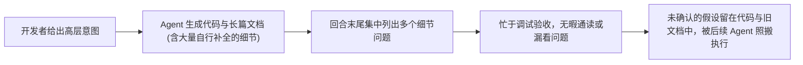
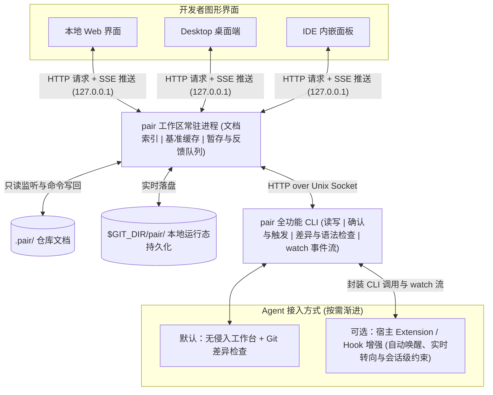
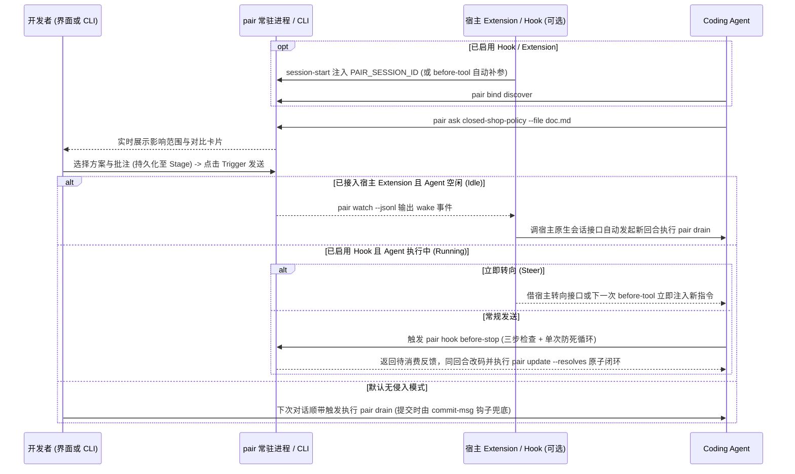

# Pairwise 产品与架构设计文档

> 面向 Vibe Coding 的通用、仓库原生实时结对工具：降低阅读与维护文档的心智负担，让文档跟随代码实时演进。

---

## 1. 要解决的问题

在 Vibe Coding 中，代码与文档大多由 Agent 编写，开发者的精力需要同时顾及**对话、调试、验收和整理**。只依赖「对话窗口 + 传统长篇 Markdown」会出现四个问题：



| 问题 | 具体表现 | 影响 |
| --- | --- | --- |
| **1. 长篇文档阅读成本高，且容易误导后续 Agent** | 开发者通常只提供少量核心意图，其余交互细节与边界条件由 Agent 自行补全，并混在同一篇长文档中按正式规则写出。 | 开发者难以逐行通读核实；后续 Agent 则会将这些未经确认的默认假设当作明确要求严格执行，产出不符合预期的结果。 |
| **2. 问题集中在回合末尾提出，容易遗漏** | 为避免中途打断执行，Agent 往往先按猜测完成实现，再在回复末尾集中列出多项细节疑问。 | 开发者此时主要关注运行效果与调试，一旦未逐条留意和回复，这些问题就会留在对话历史、文档角落或代码 `TODO` 中无人处理。 |
| **3. 决策缺少完整上下文** | 遇到设计取舍时，Agent 通常只给出简短提问和相关文件路径；若将问题暂时搁置，后续集中处理时又涉及多个不同模块。 | 开发者需要自行翻阅源码、排查受影响的页面与调用链路并评估改动后果，决策成本高。 |
| **4. 同一事实分散记录，文档容易过期** | 产品规则与接口差距常分散在多份文档和代码注释中；一旦对话提前结束或切换话题，往往来不及同步更新文档。 | 代码演进后旧描述仍留在原处（Doc Rot），需要开发者额外投入精力手工核对和整理。 |

---

## 2. 产品定位与设计原则

### 2.1 产品定位与命名约定

**Pairwise**（命令行 `pair`，仓库目录 `.pair/`）是一款**与具体编程语言、框架无关的通用开源开发工具**。它从 Git 仓库直接读写纯文本文档，以**具备完整能力的 CLI 与单进程常驻服务**为底座，向上提供桌面 / Web 可视化界面。默认作为无侵入的外部工作台供 Agent 与开发者使用，也可按需接入各类终端与 IDE 宿主插件（Extension）或 Hook 获得自动唤醒、实时转向与更强的同步约束。

### 2.2 设计原则

- **默认无侵入，按需增强约束**：默认形态仅靠 CLI、轻量 Skill 指引与提交前差异检查（`pair check --diff`）工作，不强制拦截原生工具调用；实时会话级约束、自动唤醒与中途转向由可选的宿主 Extension / Hook 提供。
- **优先保障开发体验（DX）**：开发者只负责查看关键结构与确认方案；影响范围排查、图表更新、过期过渡项清理由 Agent 完成，不需要人工整理文档。
- **面向模型友好的 CLI 交互**：命令输出与报错信息直接附带面向模型的下一步行动说明与修复命令指引，减少模型试错轮次。
- **跨技术栈通用**：核心功能不依赖特定编译器、UI 框架或测试截图环境，同样适用于客户端（Flutter、Compose Multiplatform、iOS/Android）、后端（Go、Java、Rust）、Web 与命令行项目。
- **状态精简与明确的信任边界**：
  - 不要求手动维护主观分类标签（如 `Locked / Flexible` 或优先级标签），也不在业务源码中写入行号引用或产品决策注释；
  - 仓库持久层仅记录**待确认问题文件**（`decisions/*.md` 存在即待决）、**区块确认内容哈希**（`confirmed_hash`）、**待确认假设列表**（`assumptions`）与**已撤回待知晓假设列表**（`retracted`）；
  - **威胁模型**：工具机制旨在防止 Agent 在日常更新时**误写或覆盖**确认状态，不设防蓄意伪造 Git 提交。Git 历史中的状态值默认可信，异常改动由常规 Code Review 与 `pair check` 发现。
- **图形增强且真正兼容 GitHub 渲染**：在工作台中将 Mermaid 与预设标记块渲染为交互视图；在 GitHub 或普通编辑器中隐藏控制注释，100% 按原生标准 Markdown 渲染。

---

## 3. 仓库内文档组织与语法规范（`.pair/`）

### 3.1 目录结构、全局配置与跨分支合并驱动

```text
.pair/
├── .gitattributes                 # 注册自定义合并驱动 (*.md merge=pair)，解决跨分支 Frontmatter 冲突
├── config.toml                    # 全局配置（忽略路径规则 ignore_globs、宿主等待超时 ask_wait_timeout_secs 等）
├── modules/                       # 【常驻 · 模块文档】按页面或核心子系统划分
│   ├── discover.md
│   └── account-session.md
├── flows/                         # 【常驻 · 业务流程】跨多个模块的完整交互链路或调用时序
│   ├── meal-decide.md
│   └── sms-login.md
└── decisions/                     # 【临时 · 待确认问题】仅存放当前分支尚未确认的设计取舍
    └── closed-shop-policy.md      # 经 pair update --resolves 合入全部目标后由工具自动删除
```

- **三类文档统一使用 Frontmatter**：
  - `modules/*.md`：包含 `id`、`scope`（关联源码目录 Glob 列表）与 `sections`（区块确认元数据）；
  - `flows/*.md`：包含 `id` 与 `sections`（无源码 `scope`，关联模块由正文中引用的 `@module#sec` 自动推导）；
  - `decisions/*.md`：包含 `id`、`targets`（受影响的 `module#sec` 列表）与 `default_option`（超时或未决期间采用的默认方案 ID）。
- **随分支隔离与跨分支自动合并**：`.pair/` 跟随当前 Git 分支演进，合并主干前可通过 `pair check --strict` 检查是否残留未决的 `decisions/*.md`。针对多分支并行修改同一模块导致 YAML Frontmatter 邻行冲突的问题，`pair init` 在 `.pair/.gitattributes` 中配置自定义 Git Merge Driver（`pair merge-driver %O %A %B`），在执行 `git merge / rebase` 时自动按 Frontmatter 字典键与正文区块做结构级三路合并。

### 3.2 扁平区块切分、内容寻址 `confirmed_hash` 与假设追踪

```markdown
---
id: discover
scope:
  - "lib/features/discover/**"
  - "lib/data/recommend/**"
sections:
  stage:
    confirmed_hash: "a84f21c09e12"
  tabs:
    confirmed_hash: "3b91e04d77a1"
    assumptions:
      - id: shared-sort
        text: "三个分类共用同一排序状态，切换分类不重置"
      - id: no-mealtime
        text: "按非推荐排序请求列表时不传饭点过滤参数"
    retracted:
      - id: auto-reset-tab
        text: "切走页面再返回时自动重置回第一个分类"
---

## 舞台与转盘 <!-- #stage -->
...

## 分类栏与排序 <!-- #tabs -->
### 浮层交互
...
```

1. **仅二级标题作为受管区块（消除嵌套歧义）**：
   - 文档统一按二级标题 `## 标题 <!-- #id -->` 切分为**互不重叠的扁平区间**（从当前 `##` 起至下一个 `##` 前止）。
   - 二级标题内部的 `###` / `####` 仅作排版或预设组件子项使用，完整归属于所在的二级区块，不单独进入 Frontmatter 的 `sections` 表。修改标题文字不影响 `<!-- #id -->` 锚点，合并时不会被误判为删旧增新。
2. **以 `confirmed_hash` 作为内容寻址指针（无需回写提交 SHA）**：
   - **保留缩进的归一化规则**：Markdown 列表层级与代码块缩进具有明确语法语义，计算 `confirmed_hash` 时**仅统一换行符（`\r\n` → `\n`）、去除行尾多余空白字符及区块首尾空行，严格保留行首缩进与正文空白**。
   - **跨机器按历史反查原文**：不在文件中记录提交 SHA（否则提交后回写 SHA 会再次弄脏工作区）。本机未提交前可直接从 `$GIT_DIR/pair/bases/` 读取确认原文；换机器或克隆后需要对比差异时，常驻进程沿 `git log -- <path>` 向前回溯，找到该区块归一化哈希等于 `confirmed_hash` 的历史版本作为对比起点并缓存到本地（若确认后在尚未提交入库前又被改写，历史中无匹配版本，界面直接显示「确认原文未入库」）。合并驱动无需额外处理该字段。
   - **防无谓降级**：已确认区块被小幅修改（如修错别字）时，保留原有的 `confirmed_hash` 不清空；界面对比历史确认原文，仅显示**「已确认区块含未审阅改动」并高亮改动的字词**，不会打回成整块未确认状态。
3. **逐条假设（`assumptions`）与撤回持久化列表（`retracted`）**：
   - Agent 自行补充的默认细节按短 ID 列入 `assumptions`。当 Agent 通过 `pair update --resolves <feedback-id>` 落地针对某条假设（如 `shared-sort`）的修改批注时，工具**精确移除该条已解决的假设**，同区块其余假设（`no-mealtime`）继续保留。
   - **防撤回假设在提交后丢失**：若 Agent 在未关联对应 `--resolves` 的情况下从 `assumptions` 中删去了某条已有假设，`pair update` 会自动将该条目移入同区块的 `retracted` 列表中随文件入库（而非仅对比 `HEAD`，避免提交后记录消失）。界面将其显式展示为**「Agent 撤回假设」**，直至开发者在界面点击知晓或执行 `pair stage confirm` 时一并清空。
4. **受控字段保护**：
   - `pair update` 一律忽略输入文件 Frontmatter 中携带的 `confirmed_hash` 与 `retracted` 修改，这两个字段完全由常驻进程根据历史记录、`--resolves` 闭环及 `stage confirm` 受控计算写回。

### 3.3 语法规范、闭合边界与命名空间（GitHub 原生可读）

不使用会被 GitHub 过滤标签并吞掉属性的 `<pw-*>` 自定义 HTML 标签，也不使用 GitHub 会原样渲染出字符的 `{#id}`，统一采用 **成对 HTML 注释指令 + 标准 Markdown / Mermaid / 围栏代码块**：

| 用途 | 源文件语法（强制闭合边界） | Pairwise 界面呈现 | GitHub / 普通编辑器显示效果 |
| --- | --- | --- | --- |
| **二级受管区块锚点** | `## 标题文字 <!-- #tabs -->` | 识别区块 ID `tabs` 用于引用与局部合并 | 注释完全隐藏，仅显示干净的二级标题 |
| **逻辑、时序与状态** | 标准 ``` ````mermaid ```` 代码块 | 支持缩放、节点点击与路径高亮的交互画布 | GitHub 原生渲染 Mermaid 图表 |
| **页面组件槽位结构** | ``` ````pw-layout ```` 缩进树代码块 | 统一线框风格的嵌套区块图（不画圆角字号） | 缩进清晰的纯文本层级代码块 |
| **多方案并排对比** | `<!-- pw:compare id="x" -->` ... `<!-- /pw:compare -->`，内部用 `#### 方案 A <!-- #opt-a -->` | 并排对比卡片，底部带一键选择按钮直连暂存区 | 成对注释隐藏，内部子标题、表格、Mermaid 按标准 Markdown 正常显示 |
| **多状态场景切换** | `<!-- pw:scenarios id="s" -->` ... `<!-- /pw:scenarios -->`，内部用 `#### 场景 <!-- #night -->` | 顶部场景切换标签栏，点击切换展示对应子节 | 成对注释隐藏，各场景按顺序纵向正常阅读 |
| **外部依赖过渡说明** | `<!-- pw:workaround id="w" -->` 包裹 `> **过渡做法（解除条件：…）**：…` 至 `<!-- /pw:workaround -->` | 可按「过渡项」单独筛选的状态卡片 | 成对注释隐藏，正文中显示为包含解除条件的标准引用块 |

- **ID 命名空间与 `pair check` 唯一性校验范围**：
  1. **文件级顶层命名空间**：二级区块 `<!-- #id -->` 与顶层组件容器的 `id="..."` 在**单个文件内**共享命名空间，必须唯一（供跨文件 `@module#id` 引用）；
  2. **容器局部命名空间**：`pw:compare` 与 `pw:scenarios` 内部的子项锚点（如 `<!-- #opt-a -->`）作用域**仅限所属父容器内部**（完整定位路径为 `module#x/opt-a`），在父容器内唯一即可。

---

## 4. 界面呈现与决策支持

### 4.1 差异与假设过滤（无需逐条打卡确认）

界面支持一键过滤「仅看含未确认 `assumptions`、撤回假设或相对 `confirmed_hash` 有局部变动的区块」：
- 开发者浏览时认为合理的默认实现可直接略过，**不强制逐条点击确认**；
- 发现某条假设或局部改动不符预期时，点击添加修改说明（进入暂存区），或随手点确认更新 `confirmed_hash`。

### 4.2 决策上下文与可配置 `--wait` 超时

1. **广度与深度前置**：Agent 调用 `pair ask` 提交问题文档时，必须列出全仓所有受影响模块（广度），并通过 `pw:compare` 写明各候选方案在不同场景下的具体后果（深度）。
2. **按宿主配置 `--wait` 超时**：针对高影响范围的基础问题，Agent 可调用 `pair ask <id> --file <doc.md> --wait [--timeout <sec>]` 等待确认。默认超时秒数在 `.pair/config.toml` 的 `ask_wait_timeout_secs` 中按项目所用宿主上限配置（内置默认值 `90` 秒，低于 Claude Code 默认 120 秒上限）：超时前确认则立即返回所选方案；超时未响应则以退出码 `0` 正常返回「暂未确认，请先按 `default_option` 继续执行，问题已保留在队列中」（支持后台任务的宿主也可异步运行等待通知）。

---

## 5. 运行时架构、数据一致性与两档接入模式

### 5.1 基于全功能 CLI 的单进程架构



- **单一接口、两个入口**：常驻进程只提供一套 HTTP 接口，同时监听工作树私有的 Unix Domain Socket（供 CLI 调用，Windows 10 1803 起原生支持 AF_UNIX，不再单独实现 Named Pipe）与 `127.0.0.1` 端口（供图形界面调用）。任意 CLI 命令发现常驻进程未运行时自动在后台拉起，同一工作树由文件锁保证只有一个实例。
- **单向推送用 SSE**：状态变更与 Trigger 事件只需从常驻进程推向界面和插件，界面的操作走普通 HTTP 请求，因此推送采用 SSE 而非 WebSocket。事件按递增序号持久化在 `$GIT_DIR/pair/` 中，断线重连时凭 `Last-Event-ID` 补发错过的事件；`pair watch --jsonl` 读取的是同一条事件流。
- **本地端口的访问隔离**：`pair serve --open` 启动时生成一次性访问令牌并附在打开的地址中，常驻进程同时校验 `Host` 与 `Origin`，防止其他网页借 DNS 重绑定访问本地端口。
- 具体的库与工程选型见 [技术选型](tech_stack.md)。

### 5.2 运行态持久化、`--base` 合并语义与外部手改处理

- **本地持久化（`$GIT_DIR/pair/`）与分支切换**：在当前工作树私有的 Git 目录（普通仓库为 `.git/pair/`，多 Worktree 对应 `.git/worktrees/<name>/pair/`）持久化保存暂存区（Stage）、待消费队列、活跃会话与历史基准缓存，重启后完整恢复且不污染 `git status`。监听到 `.git/HEAD` 切换分支时，立即按新分支重建索引，并将绑定在旧分支上的合并基准与会话绑定置为失效，原分支未发出的暂存项按分支名挂起保留。
- **`--base` 的精确语义、保留策略与必填校验**：
  1. **整文件基准哈希**：`--base <hash>` 始终是**目标文件整体的 SHA-256 前 12 位哈希**（由 `pair show` 或 `pair bind` 输出，即使只查看单区块 `pair show discover#tabs` 也返回该时刻 `discover.md` 的整文件哈希，作为 Frontmatter 与正文区块三路合并的共同祖先版本）。
  2. **缓存与淘汰**：每次对外输出基准哈希时，常驻进程将对应文件全文存入 `$GIT_DIR/pair/bases/<hash>`，保留最近 7 天或最近 100 个快照（按 LRU 清理；若对应内容已在 Git 对象库中也可直接回退读取）。
  3. **漏传拒绝防误覆盖**：更新已存在的文档时，若未处于已记录基准的 `bind` 会话中且漏传 `--base`，`pair update` **直接拒绝写入**，防止盲目覆盖前序内容；仅新建尚不存在的文档时免传 `--base`。
- **外部直接编辑 `.pair/*.md` 的边界（禁止监听期静默回写）**：
  1. `pair update <id[#sec]>` 支持直接从 stdin 读取局部区块内容，免建临时文件；开启 Hook 时 `before-tool` 会拦截针对 `.pair/**` 的原生 `Edit / Write` 工具引导改用 `pair update`。
  2. 在未开启 Hook 的默认模式下，文件系统监听无法区分是「开发者在编辑器手改」还是「Agent 用 `Edit` 直接改」，因此统一按「含未审阅改动」展示（开发者手改后可在界面点确认或运行 `pair stage confirm`）。
  3. **绝不在文件监听回调中静默回写 `.pair/*.md`**：后台改写文件会改变时间戳与内容，导致宿主编辑器或 Agent 报「文件被外部修改需重读」错误。异常的 Frontmatter 改动仅在工作台提示，留待下次执行 `pair update` 时修正或由 `pair check` 报错。

### 5.3 两档接入模式详解

#### 第一档（默认）：无侵入工作台模式 + Git 提交钩子兜底
默认档不挂载 Agent 会话级 Hook，Agent 通过 `SKILL.md` / `AGENTS.md` 指引调用无状态命令（`show`、`lookup`、`ask`、`update --base <hash>`、`drain`）协同工作。
- **同步保障边界与 Git 级兜底**：由于默认档没有 `before-stop` 实时拦截，对话过程中若 Agent 未按指引更新文档，单靠自觉无法保证同步。为此提供**无需会话身份、覆盖任意 Agent 与人工提交的 `pair check --diff`**（本地挂在 Git **`commit-msg`** 钩子上以便读取完整提交信息，CI 中作为 PR 检查对比目标分支）：
  - 根据 `git diff`（本地 `commit-msg` 检查暂存区 `--cached`，CI 检查分支区间）找出改动源码落入哪些模块的 `scope`（排除 `config.toml` 全局忽略路径）；
  - 若命中模块对应的 `.pair/modules/<id>.md` 未发生修改，且提交信息中无 `Pair-Skip: <原因>` trailer，则报错列出漏更新模块与修复命令。
  - *定位说明*：`check --diff` 只验证关联模块文件是否有改动（哪怕仅改动一处文字也视为通过），属于防止彻底漏改文档的底线兜底，而非语义完整性强约束。
- **与 Hook 档打通（`prepare-commit-msg` 自动补 Trailer）**：配套提供 Git **`prepare-commit-msg`** 钩子——若常驻进程中已记录当前工作树通过 `--preserve <reason>` 或 `pair skip-update --reason <reason>` 登记过的跳过原因，提交时自动向提交信息末尾追加 `Pair-Skip: <reason>`（提交后清除待用记录），无需开发者或 Agent 手写，避免 `before-stop` 放行后在提交阶段被二次拦截。

#### 第二档（可选）：接入 Extension / Hook 增强模式
当开发者在常用主力环境（如 Claude Code、OpenCode、VS Code / Cursor、JetBrains）中启用插件或生命周期 Hook 时，解锁自动唤醒、实时转向与回合内防漏检查：

1. **会话身份对齐的四级路径（确定性硬路径优先，消除 CLI 与 Hook 错位）**：
   - **路径 ①（首选 · `session-start` 环境文件注入）**：在支持会话环境文件的宿主（如 Claude Code 的 `CLAUDE_ENV_FILE`）中，`pair hook session-start` 直接写入 `export PAIR_SESSION_ID=<session_id>`，此后该会话所有 Bash 子进程天然携带同一 ID，无需模型传参。
   - **路径 ②（首选 · `before-tool` 自动改写入参）**：在支持 `PreToolUse` 修改工具入参（`updatedInput`）的宿主中，`pair hook before-tool` 检测到 Bash 调用 `pair ...` 未带 `--session` 时自动补入 `--session <session_id>`。
   - **路径 ③（回退 · 注入短码传参）**：宿主不支持前两项时，由 `prompt-submit` Hook 将宿主 `session_id` 映射为短码注入本轮上下文提示，由模型执行 `pair bind discover#tabs --session <tok>` 关联。
   - **路径 ④（兜底 · `after-tool` 输出捕获）**：若模型漏传 `--session`，紧随 Bash 触发的 `after-tool` Hook 同时持有宿主 `session_id` 与 `pair bind` 输出文本中的唯一 `bind_id`，常驻进程自动完成绑定。

2. **多会话并行绑定与区块冲突判定（零额外协商轮次）**：
   - 任一方带 `--preserve <reason>`（声明只修缺陷/调样式/重构、不改文档）时直接并行放行，返回内容末尾单向附带另一会话在改区块提示；
   - 双方均改文档但绑定的 `<!-- #id -->` 区块不重叠时直接并行放行，提交时基于各自会话缓存的 `base` 按区块自动三路合并；仅在命中同一区块时当场返回冲突提示。

3. **通过 `pair update --resolves <id>` 精确闭环反馈与清理临时文件**：
   - `pair drain` 输出每条已触发反馈时均附带唯一 ID（待确认问题的 `decision-id` 或批注的 `feedback-id`）。
   - Agent 修改代码后调用 `pair update <module[#sec]> --base <hash> --resolves <id>`，由常驻进程**原子完成**：合并文档内容、精确移除该条反馈对应的 `assumptions` 项、在会话中标记该反馈已闭环，并在问题的所有关联 `targets` 均更新完毕后**由工具自身删除 `.pair/decisions/<id>.md`**（避免 Agent 需要绕过 `.pair/**` 写拦截去手动执行 `rm`）。
   - **无需改动的目标显式结案（`--no-change`）**：若按选定方案某个 `target` 的现有文档已经成立、无需修改（如方案 A 只影响发现页，选店页规则保持不变），Agent 执行 `pair update <module#sec> --resolves <id> --no-change "<原因>"`。工具不写入正文、无需 `--base`，仅将该目标标记为「已核对 · 无需改动」并记录原因（界面在决策结案记录中展示）；该目标同样计入 `targets` 完成度，所有目标均已更新或显式结案后即删除问题文件，避免 decision 因等不到更新而永久残留。`before-stop` 第 2 步同样将其视为已闭环。

4. **生命周期 Hook 分工与完整 `before-stop` 三步判断规则**：
   - **`pair hook before-tool`（挂载 `PreToolUse`）**：① 优先检查队列中是否有立即转向（`Steer`）指令，有则即使在读代码、搜文件阶段也立即切入注入（注：无插件时若正阻塞在单条长耗时编译/测试命令内部，需等该命令返回或人工中断后注入）；② 拦截对 `.pair/**` 的直接 `Edit / Write`；③ 写业务源码触及未绑定模块 `scope` 时提示先执行 `pair bind`。
   - **`pair hook after-tool`（挂载 `PostToolUse`）**：记录修改过的源码路径，并在必要时完成路径 ④ 的 `bind_id` 兜底关联。
   - **`pair hook before-stop`（挂载 `Stop`）按以下三步顺序确定性判断**：
     1. **检查待消费反馈队列**：若存在已点击 `Trigger` 发送但尚未 `drain` 的反馈，直接拦截并返回反馈内容，要求当回合一并处理；
     2. **检查已读反馈是否通过 `--resolves` 闭环**：若本回合通过 `pair drain` 读取过反馈，精确核对每条反馈 ID 是否均已通过 `pair update --resolves <id>` 完成目标更新与 `decision` 清理（无需按时间先后猜测）；未完成则拦截列出剩余未闭环的 ID 与目标模块；
     3. **结合 `pair bind` 模式核对源码修改**：
        - **默认模式（`pair bind discover`，新增功能或调整业务规则）**：若修改了模块 `scope` 下的源码，却全程未调用 `pair update` 或 `pair ask`，拦截提示更新文档（若排查后确认确实不涉及规格变更，执行 `pair skip-update --reason "..."` 即可放行，原因同步记入待提交记录供 `prepare-commit-msg` 自动生成 trailer）；
        - **保持规格模式（`pair bind discover --preserve "修复返回栈异常"`，修缺陷、调样式或内部重构）**：开局已声明不改既有规则，回合结束时即便修改了源码且未动 `.pair/` 也**直接放行，零额外交互耗时**，并将原因记入待提交记录（中途若发现必须改规则仍可随时调用 `pair update` / `pair ask`）。
     - **单回合防死循环保护**：检查宿主的 `stop_hook_active` 标记并在常驻进程记录 `(session_id, 拦截原因哈希)`；除新到达的 `Trigger` 反馈外，同一原因在单回合内**最多只拦截一次**，第二次尝试结束时直接放行并在工作台标记待核对状态。



---

## 6. 存量仓库全仓迁移与新项目初始化

接入已有项目时统一执行**全仓迁移**，避免新旧两套文档长期并存：

1. **初始化与钩子配置**：执行 `pair init` 创建 `.pair/` 目录、生成 `config.toml`、写入 `.pair/.gitattributes` 注册 Git 合并驱动、按需安装 Git `prepare-commit-msg` 与 `commit-msg` 钩子，并输出全仓迁移任务指引。
2. **梳理拓扑与归拢遗留问题**：引导 Agent 扫描源码与旧 `docs/`，拆分为带 `scope` 与 `<!-- #id -->` 锚点的 `modules/` 和 `flows/`；将业务类代码 `TODO` 迁入 `pw:workaround` 块；将旧文档矛盾或与代码不符之处写入 `decisions/` 待确认。
3. **来源初始化与旧文档归档**：迁移生成的区块均不带 `confirmed_hash`（初始为未确认状态），核对后归档或移除原有的重复长篇综述文档。

---

## 7. CLI 交互提示规范与命令列表

### 7.1 面向模型的引导式输出与明确错误提示

默认文本输出模式（未传 `--json` 时）专为模型阅读设计：成功返回时附带下一步操作提示，失败或拦截时直接给出明确原因与可直接执行的修复命令，避免模型盲目猜测参数。

- **成功返回附带引导示例**（`pair drain`）：
  ```text
  已读取 1 条开发者确认反馈：
  - [id: closed-shop-policy] 选择方案 opt-a (按场景分流：发现页剔除，搜索与选店保留)
    受影响目标: discover#list, pick-shop#list

  下一步要求：请按上述结论修改业务代码，随后对每个受影响模块执行 `pair update <module#sec> --base <hash> --resolves closed-shop-policy`（某目标确认无需改动时改用 `pair update <module#sec> --resolves closed-shop-policy --no-change "<原因>"`）；全部目标更新或显式结案后工具将自动删除 `.pair/decisions/closed-shop-policy.md`。
  ```
- **失败返回明确修复指令示例**（`pair update` 漏传 `--base`）：
  ```text
  拒绝更新：模块 `discover` 已存在，但本次调用未提供基准哈希 `--base`，直接写入可能覆盖已有内容。
  修复操作：请先执行 `pair show discover` 读取最新内容并获取文件末尾输出的 base 哈希，再重新执行 `pair update discover#tabs --base <hash> <<'EOF'`。
  ```

### 7.2 命令列表

```bash
# 1. 初始化、常驻服务与查询检查
pair init [--git-hooks]                                # 初始化 .pair/、配置 merge driver 及可选 Git 提交钩子
pair serve [--open]                                    # 启动或连接当前工作树的常驻进程，可选打开本地界面
pair status                                            # 查看文档概况、未决问题、未审阅区块与暂存队列
pair list [modules|flows|decisions]                    # 列出模块、流程与待确认问题
pair show <id[#sec]>                                   # 查看内容并在输出末尾附带当前整文件 base 哈希与更新提示
pair lookup <path...>                                  # 根据源码文件路径反查关联的模块文档
pair check [--strict] [--diff [<base-ref>]]            # 语法与引用校验；--diff 作文件级联动兜底检查

# 2. Agent 协作与文档更新（支持 stdin 输入，忽略输入中的 confirmed_hash 与 retracted）
pair ask <id> --file <doc.md> [--wait [--timeout <s>]] # 提交待确认问题（默认超时取自 config.toml）
pair update <id[#sec]> [--file <doc.md>] --base <hash> [--resolves <id...>] # 三路合并更新并原子闭环指定反馈/删除已决问题
pair update <id#sec> --resolves <id> --no-change <reason>                  # 目标无需改动时显式结案，计入 targets 完成度
pair drain                                             # 读取已触发（Trigger）的开发者反馈及对应反馈 ID

# 3. 开发者决策与反馈发送（界面操作与下列命令一一对应）
pair stage decide <id> --pick <opt>                    # 将问题选择结果持久化至暂存区（可附带 --note）
pair stage note <id#sec> [--assumption <aid>] <msg>    # 针对区块或其中某条具体假设添加修改说明至暂存区
pair stage confirm <id#sec>                            # 计算写入当前区块 confirmed_hash，并清空已阅假设与 retracted 列表
pair trigger [--steer]                                 # 发送暂存区反馈（--steer 触发立即转向）

# 4. 可选 Extension、会话关联与 Git 钩子命令
pair bind <id[#sec]...> [--session <id>] [--preserve <msg>] # 关联宿主会话与目标模块区块，缓存整文件合并基准
pair skip-update [--session <id>] --reason <text>      # 默认绑定模式下确认本次修改不改规格，放行并登记待提交跳过原因
pair watch [--session <id>] --jsonl                    # 持续输出状态变更与 Trigger 事件流，供插件或界面订阅
pair session state <idle|running|waiting> [--session <id>] [--capabilities <list>]
pair hook <session-start|prompt-submit|before-tool|after-tool|before-stop>
pair git-hook <prepare-commit-msg|commit-msg>          # 自动追加已登记的 Pair-Skip trailer 并在 commit-msg 阶段执行检查
pair merge-driver <base> <ours> <theirs>               # 供 Git merge/rebase 自动调用的结构化三路合并驱动
```
